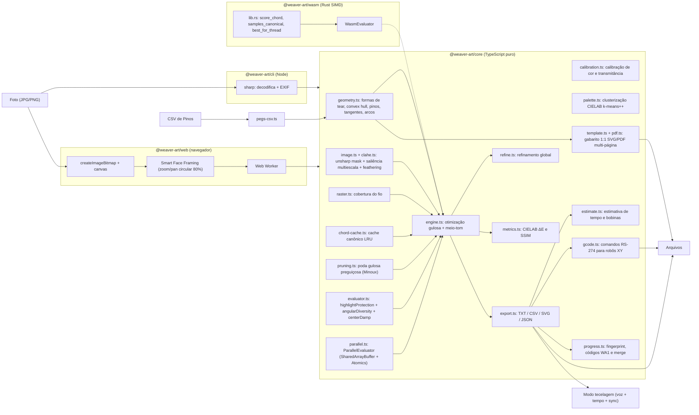

# Arquitetura

## Visão geral

## Pacotes

| Pacote             | Responsabilidade                                                                                                   | Dependências de runtime                |
| ------------------ | ------------------------------------------------------------------------------------------------------------------ | -------------------------------------- |
| `@weaver-art/core` | modelo físico, CLAHE, meio-tom, otimização, refinamento, métricas, calibração, gabarito PDF/SVG, G-code, progresso | **nenhuma**                            |
| `@weaver-art/wasm` | kernel computacional SIMD em Rust compilado para WebAssembly (`f32x4`), com fallback TS e paridade bit a bit       | **nenhuma** (bytecode base64 embutido) |
| `@weaver-art/cli`  | ler/gravar arquivos, decodificar imagens, calibração, subcomandos template/gcode/estimate, progresso no terminal   | `sharp`, core, wasm                    |
| `@weaver-art/web`  | UI, Web Workers, pré-visualização, modo tecelagem com voz, gabaritos de fabricação e sincronização                 | core, wasm                             |

### Por que um core sem dependências?

O motor precisa rodar em três lugares: no **Node** (CLI, testes), no **navegador** (dentro de um
Web Worker) e em WebAssembly/threads. Ele só conhece `RasterImage` (RGBA8 — compatível com
`ImageData` e com a saída crua do `sharp`) e `Float32Array`. Até mesmo o gerador de arquivos PDF vetoriais em escala 1:1 (`pdf.ts`) é implementado do zero em TypeScript puro sem nenhuma biblioteca externa (`pdfkit`, etc.). Nada de DOM, `fs` ou `Buffer`.

O pacote `@weaver-art/wasm` complementa o core fornecendo aceleração SIMD nativa de baixo nível sem violar essa pureza: o binário WASM é pré-compilado e embutido como string Base64 decodificada em tempo de inicialização, operando diretamente sobre typed arrays em memória linear.

### Por que TypeScript e Rust/WASM?

- **TypeScript puro** no core para portabilidade universal instantânea, sem necessidade de toolchain ou etapas de compilação nativa para quem vai tecer no navegador ou usar a API.
- **Rust/WASM SIMD** (`@weaver-art/wasm`) para aceleração extrema de hardware (vetorização de 128 bits via `core::arch::wasm32::*`), processando até 4 pixels simultaneamente no cálculo de ganho e amostragem antisserrilhada com **paridade numérica exata bit a bit** em relação ao TypeScript.
- **Paralelismo multi-worker** (`parallel.ts`) coordenado via memória compartilhada (`SharedArrayBuffer`) e sincronização de barreira sem travamento (`Atomics`), dividindo o espaço de candidatos entre múltiplos núcleos lógicos de CPU.

## Camada de Avaliação e Desempenho

O motor desacopla a busca de cordas através da interface `CandidateEvaluator`:

1. **`JsEvaluator`**: Implementação pura de referência em TypeScript, com buffers estáticos reutilizados para evitar alocações de GC durante o loop de tecelagem.
2. **`WasmEvaluator`**: Instância do kernel WebAssembly compilado a partir de Rust `no_std`, executando vetorização `f32x4` e busca do melhor candidato diretamente em memória linear.
3. **`ParallelEvaluator`**: Distribui blocos contíguos de pinos candidatos para $N$ workers (Web Workers no navegador ou `worker_threads` no Node.js) via `SharedArrayBuffer` estruturado, utilizando desempate determinístico (maior ganho líquido seguido de menor índice de pino).
4. **`ChordCache`**: Cache LRU de amostras canônicas com chave de 64 bits baseada na orientação física das tangentes ($A \le B$). O teto de memória é parametrizável (ex.: 128 MB no CLI, 64 MB na web) e limpa automaticamente entradas antigas sem afetar a fidelidade visual.
5. **`StaleGainTable` (Poda Gulosa de Minoux)**: Algoritmo acelerado para funções submodulares (Minoux, 1978). Mantém os ganhos calculados em passos anteriores e reavalia candidatos sob demanda na ordem do limite superior de ganho, alcançando acelerações de até 4–5× mantendo exatidão matemática estrita em simulações monocromáticas e $\Delta\text{RMSE}/\Delta\text{SSIM} \le 2\%$ em cores/meio-tom.

## Fluxo de dados

1. **Configuração de Geometria** → `LoomConfig` (`CircleLoomConfig | RectangleLoomConfig | CustomLoomConfig`).
   - `createLoom()` calcula posições físicas dos pinos em mm, envoltória convexa (`convexHull`), normais externas para rótulos legíveis e a máscara de cordas admissíveis (`chordMask`), eliminando cordas que coincidam com a mesma aresta do quadro.
   - Pinos arbitrários podem ser importados ou exportados via `parsePegsCSV` e `toPegsCSV`.
2. **Entrada de Imagem** → `RasterImage` (RGBA8, sRGB).
3. `prepareTarget()` → `TargetImage` (`S×S`, 1 ou 3 canais em luz linear, máscara de enquadramento `loomFrameCrop` + `loomMask`, pesos com suporte a CLAHE adaptativo, `shadowLift`, desfoque retiniano por distância de observação e mapa de saliência Sobel `edgeEmphasis`).
4. `WeaveEngine` mantém `canvas` (simulação), mapa de resíduo de meio-tom óptico $R_{\text{halftone}} = G * (T - C)$ (quando ativado), estado de cada fio, uso de pares de pinos e gestão de cotas por camada/fio.
   - `step()` consulta o avaliador configurado (`JsEvaluator`, `WasmEvaluator` ou `ParallelEvaluator`), aplica a estratégia (`layered`, `interleaved-balanced` ou `free`), penalidade opcional por comprimento de fio (`lengthPenalty`), transição automática entre camadas e rollover de saldo para o preto final.
   - `runChunk(n)` permite execução cooperativa (o Worker cede o event loop entre blocos para
     poder receber `stop`).
5. **Refinamento Global Opcional** → `refineWeave()` executa passes de perturbação de nós intermediários ($p_{i-1} \to p_i' \to p_{i+1}$) reduzindo o erro residual sem violar a continuidade do fio nem as restrições da geometria.
6. `result()` → `WeaveResult` contendo métricas completas calculadas por `calculateMetrics()` em `metrics.ts`: RMSE linear, erro de cor em CIELAB ($\Delta E_{ab}^*$) e similaridade estrutural (SSIM).
7. **Exportação e Fabricação**:
   - `export.ts`: instruções (`.txt` com bloco de estimativa e agrupamento por camada), CSV detalhado e SVG vetorial 1:1 (`<g id="layer-...">`).
   - `template.ts` & `pdf.ts`: gabarito físico de furação 1:1 em SVG e PDF multi-páginas ladrilhadas para montagem com marcas de registro em cruz e réguas de validação milimétrica.
   - `estimate.ts`: estimativa de tempo ativo de tecelagem, amarração inicial, trocas e cálculo de bobinas de meada por cor com margem de segurança.
   - `gcode.ts`: geração de percursos de máquina (RS-274) para robôs ou plotters CNC de eixos XY com folga radial de pino (`toolRadius`), arcos `G2`/`G3` e pausas `M0` para troca de fio.
   - `progress.ts`: persistência, geração de códigos curtos com checksum (`WA1-...`) e reconciliação pelo timestamp mais recente (`mergeProgress`).

## Convenções

- **Unidades:** grandezas físicas em mm; quantidades da grade com sufixo `Px`.
- **Pinos:** índice 0-based no código/JSON; exibidos a partir de 1 nas instruções e na UI.
- **Lados:** `+1` anti-horário, `−1` horário (vistos de frente).
- **Cores:** `#rrggbb` sRGB na configuração; luz linear dentro do motor.
- **Idioma:** documentação e textos de interface em português; identificadores e comentários de
  código em inglês.

## Testes

Vitest roda os testes de `packages/*/test` com imagens sintéticas (sem binários no repositório):

- invariantes geométricas (tangência exata, arcos, distância circular, polígonos convexos e detecção de bordas retangulares);
- conservação de área na rasterização e canonicalização de segmentos;
- paridade numérica exata bit a bit entre o avaliador TypeScript e o kernel WebAssembly SIMD (`parity.test.ts`);
- consistência e invariantes da poda gulosa preguiçosa de Minoux (`pruning.test.ts`);
- sincronização paralela multi-thread sem travamento com desempate determinístico (`parallel.test.ts`);
- gerenciamento de limite de memória e conformidade LRU do cache de cordas (`chord-cache.test.ts`);
- motor: erro decrescente, continuidade do fio, restrições de pinos, contabilidade do comprimento,
  múltiplos fios e modelo de meio-tom óptico;
- exportadores: SVG, CSV, JSON, TXT, gerador PDF 1.4 com offsets xref válidos, gabaritos de furação e G-code;
- parsers e sincronização: importação/exportação CSV de pinos, códigos curtos de progresso e reconciliação.

## Arquitetura do Sistema e Contratos de Integração

### 1. Estrutura de Camadas (Clean Architecture)

O monorepo é dividido estritamente entre o **Core Matemático em Rust (`crates/*`)** e a **Aplicação Web em TypeScript (`apps/web/src/*`)**:

1. **Camada 1 — Domínio Puro (`crates/weaver-domain`):**
   - `geometry/`: `LoomGeometry` polimórfico (Pino 0 sempre em $-\pi/2$), diagnóstico de furação (`drilling.rs`) e tangentes de pinos cilíndricos (`tangents.rs`).
   - `color/`: Conversões exatas `SrgbColor` $\leftrightarrow$ `LinearRgbColor` $\leftrightarrow$ `LabColor`, métricas $\Delta E$ e projeção de _Gamut_ convexo.
   - `matrix/`: `SparseChordMatrixCSR` (`chord_offsets`, `pixel_indices`, `pixel_weights`) e rasterizadores de Bresenham e Xiaolin Wu.
   - _Regra:_ Zero dependências de outros crates internos ou de navegador.

2. **Camada 2 — Motores de Aplicação (`crates/weaver-dsp`, `crates/weaver-solvers`, `crates/weaver-cam`):**
   - `weaver-dsp`: Enquadramento afim (`framing.rs`), CLAHE (`contrast.rs`), Morfologia (`morphology.rs`), Sobel/Canny (`edges.rs`), Mapa de Importância (`importance.rs`) e Transformada de Radon (`radon.rs`).
   - `weaver-solvers`: Matriz de estado _Struct-of-Arrays_ (`state_matrix.rs`), modelos ópticos (`optical_models.rs`), agendador de carretéis (`spool_scheduler.rs`), métricas incrementais $O(\vert{}L\vert{})$ (`telemetry_metrics.rs`) e solvers (`greedy.rs`, `beam_search.rs`, `global_fista.rs`).
   - `weaver-cam`: Paginador 1:1 de folhas A4/A3 (`blueprint_tiler.rs`), gerador PDF vetorial (`pdf.rs`), exportador CSV (`csv_exporter.rs`), G-Code CNC (`gcode_exporter.rs`), calculadora BOM (`bom_calculator.rs`) e codec de retomada (`resume_codec.rs`).

3. **Camada 3 — Adaptador WebAssembly (`crates/weaver-wasm-adapter`):**
   - Exposto via `wasm-bindgen` para o Web Worker (`solver.worker.ts`), lendo e escrevendo diretamente no `SharedArrayBuffer`.

4. **Camada 4 — Frontend e Visualização (`apps/web/src/`):**
   - `domain-contracts/`: Contratos TypeScript e utilitários geométricos leves (`core-helpers.ts`).
   - `core-bridge/`: `WeaverEngineClient`, `SharedWorkspaceMemory` e `solver.worker.ts`.
   - `preset-engine/`: `ReactivePresetStore` (gerencia presets e visibilidade contextual sem tocar no `framing` do usuário).
   - `renderer-webgl/`: `WebGLLoomRenderer` (pipeline de 2 estágios em `RGBA16F` com inversão correta de $Y$).
   - `views/`: `studio-view`, `blueprint-view` (CAD mecânico com Nível de Detalhe / LOD dinâmico) e `player-view` (Modo Tecelagem com TTS e QR Code).

---

### 2. Layout Binário do `SharedArrayBuffer` (ADR-003)

- **Bytes `0..31` (`Int32Array[0..7]`):**
  - `[0]`: `StatusFlag` (`0=IDLE, 1=RUNNING, 2=PAUSED, 3=DONE, 4=ABORT`)
  - `[1]`: `CurrentStepIndex` ($0 \dots K_{\max}$)
  - `[2]`: `ActiveSpoolIndex` ($0 \dots M-1$)
  - `[3]`: `TotalSpoolSwitches`
- **Bytes `32..127` (`Float32Array[0..23]`):**
  - `[0]`: `CurrentRMSE`
  - `[1]`: `CurrentDeltaE`
  - `[2]`: `CurrentSSIM`
  - `[3]`: `TotalThreadMeters`
  - `[4..19]`: `ThreadMetersPerSpool[0..15]`
- **Bytes `128..EOF` (`WeavingPathBuffer`, 8 bytes por passo):**
  - `bytes 0..1`: `from_pin: u16` (Little Endian)
  - `bytes 2..3`: `to_pin: u16` (Little Endian)
  - `byte 4`: `spool_id: u8`
  - `byte 5`: `winding_flags: u8` (bit 0 = departure CCW, bit 1 = arrival CCW)
  - `bytes 6..7`: `score_normalized: u16`
