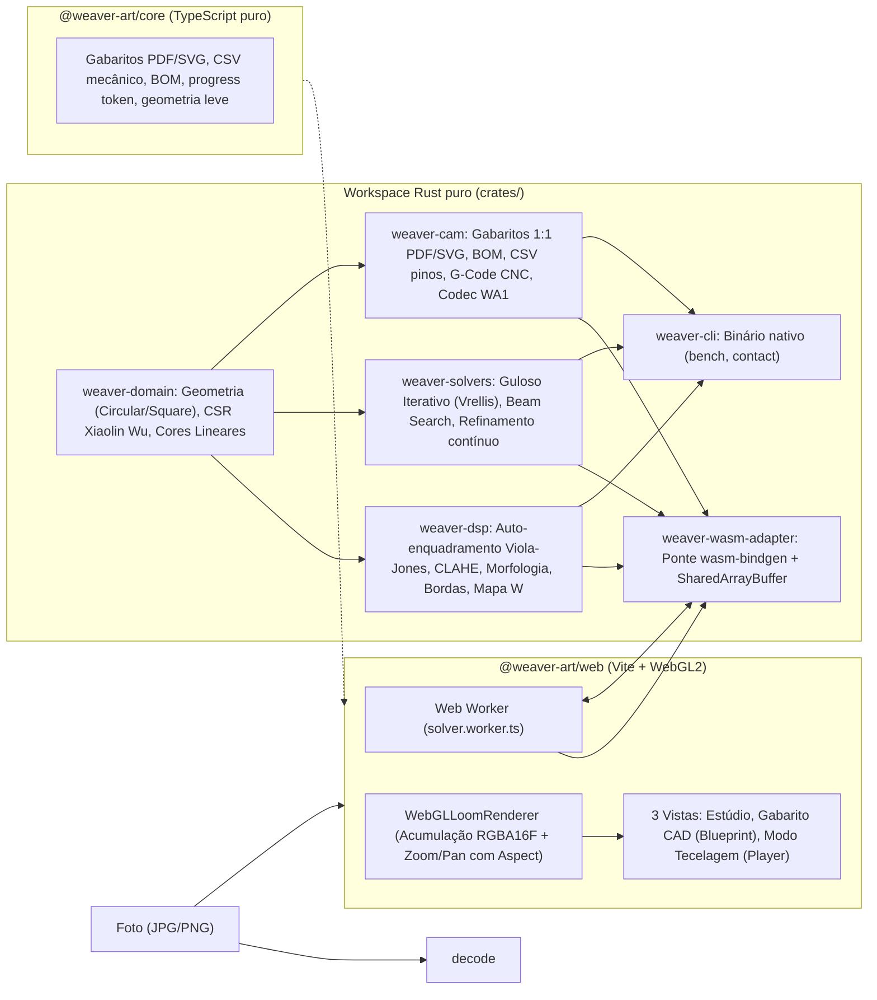

# Arquitetura

## Visão geral

## Estrutura do Workspace

| Pacote / Crate               | Responsabilidade                                                                                                    | Runtime / Dependências                              |
| :--------------------------- | :------------------------------------------------------------------------------------------------------------------ | :-------------------------------------------------- |
| `crates/weaver-domain`       | Modelo físico de tear (Circular, Quadrado), cálculo de tangentes, conversões CIELAB/Linear RGB e matriz CSR         | Rust puro (`no_std` compatível, zero deps internas) |
| `crates/weaver-dsp`          | Pipeline de imagem: Viola-Jones facial (OpenCV Haar tables), CLAHE, morfologia, Sobel/Canny, mapa $W(x,y)$, Radon   | Rust puro (depende de `weaver-domain`)              |
| `crates/weaver-solvers`      | Motores de String Art: Guloso Iterativo (Petros Vrellis), Beam Search, passe de refinamento contínuo, métricas      | Rust puro (depende de `weaver-domain`)              |
| `crates/weaver-cam`          | CAM mecânico: Tiler 1:1 A4/A3/Letter com culling de vão central, PDF 1.4 puro, CSV, G-Code CNC, BOM e codec WA1     | Rust puro (depende de `weaver-domain`)              |
| `crates/weaver-wasm-adapter` | Adaptador WebAssembly (`wasm-bindgen`), gerenciamento de `SharedArrayBuffer` / `ArrayBuffer` e cache CSR            | Rust + wasm-bindgen (Camada 3)                      |
| `crates/weaver-cli`          | Ferramenta CLI nativa para calibração, benchmarks (`weaver-cli bench`) e folhas de contato (`weaver-cli contact`)   | Rust nativo (Camada 4)                              |
| `@weaver-art/core`           | Contratos TypeScript, templates CAM PDF/SVG de fallback, cálculo de BOM e decodificação de progresso                | TypeScript puro (zero dependências)                 |
| `@weaver-art/web`            | Frontend SPA: Vite, Web Workers, renderizador físico WebGL2, navegação Zoom/Pan, Studio, Blueprint CAD e Player TTS | TypeScript + WebGL2 + Web Workers                   |

### Por que um núcleo em Rust e TypeScript?

- **Rust Workspace Puro**: Toda a computação intensiva de String Art (rasterização antisserrilhada de Xiaolin Wu, avaliação de ganhos em luz linear, matriz CSR esparsa e processamento de sinal DSP) reside em Rust compilado nativamente ou para WebAssembly (`wasm32-unknown-unknown`).
- **Comunicação Zero-Copy via `SharedArrayBuffer`**: A interface e os Web Workers comunicam telemetria atômica e passos da obra sem alocação ou cópia na heap durante o laço de tecelagem a 60 FPS.
- **Renderização Acelerada por GPU (WebGL2)**: Pipeline físico de 2 estágios com acumulação linear de alta precisão em textura `RGBA16F` e conversão perceptual IEC sRGB, com suporte a Zoom e Pan com compensação de proporção de tela (`u_aspect`).

## Camada de Avaliação e Desempenho

O motor executa a busca de cordas com as seguintes garantias de engenharia:

1. **`SparseChordMatrixCSR`**: Matriz esparsa com indexação triangular analítica $O(1)$ sem tabelas hash ou alocações na heap, respeitando o teto de memória $\le 130\text{ MB}$ para grades de alta resolução.
2. **Função Objetivo Perceptual Exata**: Ganho de cada corda calculado diretamente como a variação exata do erro quadrático ponderado no espaço perceptivo com modelo físico de transmitância linear $T = \prod (1 - \alpha c_i)$.
3. **Passe de Refinamento Contínuo**: Perturbação de nós intermediários $(a \to p \to b)$ que preserva a continuidade do fio único e reduz o erro global sem quebras.
4. **Camadas Sequenciais Físicas (`layered`)**: Ordem física obrigatória no preset CMYK (Amarelo $\to$ Magenta $\to$ Ciano $\to$ Preto) com cotas ponderadas [18% Y, 22% M, 22% C, 38% K] e rollover dinâmico para o preto final, garantindo fidelidade cromática e contraste.

## Fluxo de dados

1. **Configuração de Geometria** → `LoomPhysicalSpec` (`Circular` ou `Square`).
2. **Entrada de Imagem** → Foto (JPG/PNG).
3. **Auto-Enquadramento Facial e DSP** → Detector Viola-Jones ajusta o rosto para ocupar ~95% do aro (`DEFAULT_FACE_FILL = 0.95`). O DSP gera imagem preparada, mapa de importância $W(x,y)$, bordas e Radon.
4. **Construção da Matriz CSR** → Pré-computação das cordas admissíveis via Xiaolin Wu com cache reutilizável entre sessões.
5. **Otimização Gulosa** → `WasmWeavingEngine` executa lotes de passos gravando continuamente no `SharedArrayBuffer`.
6. **Visualização em Tempo Real** → `WebGLLoomRenderer` consome os passos a 60 FPS e desenha os quads instanciados das cordas.
7. **Modo Tecelagem e Exportação CAM** → Visualização passo a passo com voz hands-free (Player View), geração de gabaritos 1:1 em PDF/SVG multi-páginas, CSV mecânico e G-Code CNC (Blueprint View).

## Convenções

- **Unidades:** grandezas físicas em mm; quantidades da grade com sufixo `Px`.
- **Pinos:** índice 0-based no código/JSON; exibidos a partir de 1 nas instruções e na UI.
- **Lados:** `+1` anti-horário, `−1` horário (vistos de frente).
- **Cores:** `#rrggbb` sRGB na configuração; luz linear dentro do motor.
- **Idioma:** documentação e textos de interface em português; identificadores e comentários de código em inglês.

## Testes

A suíte de testes abrange o workspace completo:

- **Rust Workspace (`cargo test --workspace`)**:
  - `weaver-domain`: invariantes geométricas, tangências reais, reciprocidade, teto de memória RNF-03 da CSR.
  - `weaver-dsp`: auto-enquadramento facial Viola-Jones, filtros morfológicos, CLAHE, Sobel/Canny e Radon.
  - `weaver-solvers`: motor guloso, Beam Search, determinismo RNF-02 e convergência monotônica de erro.
  - `weaver-cam`: gabarito 1:1 multipágina, culling de vão central, geração de PDF 1.4 puro, BOM e G-Code.
  - `weaver-wasm-adapter`: integração ponta a ponta DSP + Solvers e mapeamento de memória compartilhada.
- **TypeScript / Frontend (`npm run typecheck`, `npx vitest run`)**:
  - Contratos de domínio, presets de Petros Vrellis (`VRELLIS_CLASSIC_MONO`, `VRELLIS_COLOR`) e formatos (`CIRCULAR`, `SQUARE`).
  - Renderizador WebGL2 e matemática de zoom/pan com aspect ratio.
  - CAD Blueprint, LOD dinâmico e inspeção de parede livre.
  - Player View, voz TTS, atalhos de teclado e persistência IndexedDB / QR Code.

## Arquitetura do Sistema e Contratos de Integração

### 1. Estrutura de Camadas (Clean Architecture)

O monorepo é dividido estritamente entre o **Core Matemático em Rust (`crates/*`)** e a **Aplicação Web em TypeScript (`apps/web/src/*`)**:

1. **Camada 1 — Domínio Puro (`crates/weaver-domain`):**
   - `geometry/`: `LoomGeometry` polimórfico (Circular e Quadrado, Pino 0 sempre em $-\pi/2$), diagnóstico de furação (`drilling.rs`) e tangentes de pinos cilíndricos (`tangents.rs`).
   - `color/`: Conversões exatas `SrgbColor` $\leftrightarrow$ `LinearRgbColor` $\leftrightarrow$ `LabColor`, métricas $\Delta E$ e projeção de _Gamut_ convexo.
   - `matrix/`: `SparseChordMatrixCSR` (`chord_offsets`, `pixel_indices`, `pixel_weights`) e rasterizadores de Bresenham e Xiaolin Wu.
   - _Regra:_ Zero dependências de outros crates internos ou de navegador.

2. **Camada 2 — Motores de Aplicação (`crates/weaver-dsp`, `crates/weaver-solvers`, `crates/weaver-cam`):**
   - `weaver-dsp`: Enquadramento afim (`framing.rs`, alvos `FramingTarget::Face` / `HeadAndShoulders`), detector de rostos Viola-Jones em Rust puro (`face_framing.rs` + tabelas geradas da cascata frontal do OpenCV em `haar_frontalface.rs`, licença Intel/BSD), CLAHE (`contrast.rs`), Morfologia (`morphology.rs`), Sobel/Canny (`edges.rs`), Mapa de Importância e mapa opcional de feições escuras (`importance.rs`) e Transformada de Radon (`radon.rs`).
   - `weaver-solvers`: Matriz de estado _Struct-of-Arrays_ (`state_matrix.rs`), modelos ópticos (`optical_models.rs`), agendador de carretéis (`spool_scheduler.rs`), métricas incrementais $O(\vert{}L\vert{})$ (`telemetry_metrics.rs`), solver guloso iterativo (`greedy.rs`), busca em feixe (`beam_search.rs`) e refinamento contínuo (`refine.rs`).
   - `weaver-cam`: Paginador 1:1 de folhas A4/A3/Letter (`blueprint_tiler.rs`), gerador PDF vetorial puro (`pdf.rs`), exportador CSV (`csv_exporter.rs`), G-Code CNC (`gcode_exporter.rs`), calculadora BOM (`bom_calculator.rs`) e codec de retomada (`resume_codec.rs`).

3. **Camada 3 — Adaptador WebAssembly (`crates/weaver-wasm-adapter`):**
   - Exposto via `wasm-bindgen` para o Web Worker (`solver.worker.ts`), gerenciando `SharedArrayBuffer` e inicialização sob demanda.

4. **Camada 4 — Frontend e Visualização (`apps/web/src/`):**
   - `domain-contracts/`: Contratos e tipos compartilhados TypeScript (`types.ts`).
   - `core-bridge/`: `WeaverEngineClient`, `SharedWorkspaceMemory` e `solver.worker.ts`.
   - `preset-engine/`: `ReactivePresetStore` (gerencia os 2 presets Vrellis e visibilidade contextual sem tocar no enquadramento do usuário).
   - `renderer-webgl/`: `WebGLLoomRenderer` (pipeline de 2 estágios em `RGBA16F` com Zoom/Pan com compensação de proporção de tela).
   - `views/`: `studio-view` (enquadramento e diagnóstico multi-estágio), `blueprint-view` (CAD mecânico com LOD dinâmico) e `player-view` (Modo Tecelagem com TTS e QR Code).

---

### 2. Layout Binário do `SharedArrayBuffer` (ADR-003)

- **Bytes `0..31` (`Int32Array[0..7]`):**
  - `[0]`: `StatusFlag` (`0=IDLE, 1=RUNNING, 2=PAUSED, 3=DONE, 4=ABORT`)
  - `[1]`: `CurrentStepIndex` ($0 \dots K_{\max}$)
  - `[2]`: `ActiveSpoolIndex` ($0 \dots M-1$)
  - `[3]`: `TotalSpoolSwitches`
- **Bytes `32..127` (`Float32Array[0..23]`):**
  - `[0]`: `CurrentRMSE`
  - `[1]`: `CurrentDeltaE`
  - `[2]`: `CurrentSSIM`
  - `[3]`: `TotalThreadMeters`
  - `[4..19]`: `ThreadMetersPerSpool[0..15]`
- **Bytes `128..EOF` (`WeavingPathBuffer`, 8 bytes por passo):**
  - `bytes 0..1`: `from_pin: u16` (Little Endian)
  - `bytes 2..3`: `to_pin: u16` (Little Endian)
  - `byte 4`: `spool_id: u8`
  - `byte 5`: `winding_flags: u8` (bit 0 = departure CCW, bit 1 = arrival CCW)
  - `bytes 6..7`: `score_normalized: u16`
