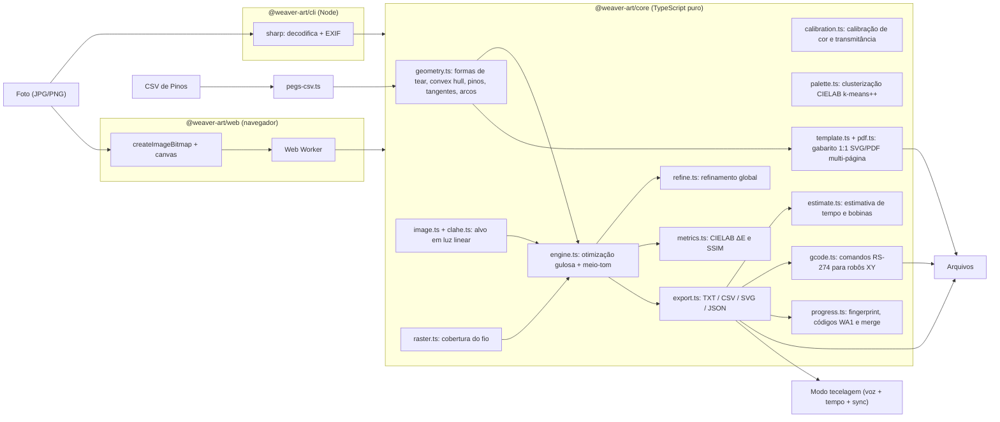

# Arquitetura

## Visão geral

## Pacotes

| Pacote             | Responsabilidade                                                                                                   | Dependências de runtime              |
| ------------------ | ------------------------------------------------------------------------------------------------------------------ | ------------------------------------ |
| `@weaver-art/core` | modelo físico, CLAHE, meio-tom, otimização, refinamento, métricas, calibração, gabarito PDF/SVG, G-code, progresso | **nenhuma**                          |
| `@weaver-art/cli`  | ler/gravar arquivos, decodificar imagens, calibração, subcomandos template/gcode/estimate, progresso no terminal   | `sharp`, core                        |
| `@weaver-art/web`  | UI, Web Worker, pré-visualização, modo tecelagem com voz, gabaritos de fabricação e sincronização                  | core (via alias para o código-fonte) |

### Por que um core sem dependências?

O motor precisa rodar em três lugares: no **Node** (CLI, testes), no **navegador** (dentro de um
Web Worker) e, no futuro, em WebAssembly/GPU. Ele só conhece `RasterImage` (RGBA8 — compatível com
`ImageData` e com a saída crua do `sharp`) e `Float32Array`. Até mesmo o gerador de arquivos PDF vetoriais em escala 1:1 (`pdf.ts`) é implementado do zero em TypeScript puro sem nenhuma biblioteca externa (`pdfkit`, etc.). Nada de DOM, `fs` ou `Buffer`.

### Por que TypeScript?

- Um único código para web (sem instalação para quem vai tecer) e linha de comando.
- Desempenho suficiente: ≈ 2 bilhões de operações por padrão rodam em segundos com typed arrays.
- O original de Vrellis é C++/openFrameworks e as referências abertas são Processing (Java); a
  separação core/app permite portar o núcleo para Rust/WASM se for necessário mais desempenho.

## Fluxo de dados

1. **Configuração de Geometria** → `LoomConfig` (`CircleLoomConfig | RectangleLoomConfig | CustomLoomConfig`).
   - `createLoom()` calcula posições físicas dos pinos em mm, envoltória convexa (`convexHull`), normais externas para rótulos legíveis e a máscara de cordas admissíveis (`chordMask`), eliminando cordas que coincidam com a mesma aresta do quadro.
   - Pinos arbitrários podem ser importados ou exportados via `parsePegsCSV` e `toPegsCSV`.
2. **Entrada de Imagem** → `RasterImage` (RGBA8, sRGB).
3. `prepareTarget()` → `TargetImage` (`S×S`, 1 ou 3 canais em luz linear, máscara de enquadramento `loomFrameCrop` + `loomMask`, pesos com suporte a CLAHE adaptativo, `shadowLift`, desfoque retiniano por distância de observação e mapa de saliência Sobel `edgeEmphasis`).
4. `WeaveEngine` mantém `canvas` (simulação), mapa de resíduo de meio-tom óptico $R_{\text{halftone}} = G * (T - C)$ (quando ativado), estado de cada fio, uso de pares de pinos e gestão de cotas por camada/fio.
   - `step()` aplica a estratégia configurada (`layered`, `interleaved-balanced` ou `free`), penalidade opcional por comprimento de fio (`lengthPenalty`), transição automática entre camadas e rollover de saldo para o preto final.
   - `runChunk(n)` permite execução cooperativa (o Worker cede o event loop entre blocos para
     poder receber `stop`).
5. **Refinamento Global Opcional** → `refineWeave()` executa passes de perturbação de nós intermediários ($p_{i-1} \to p_i' \to p_{i+1}$) reduzindo o erro residual sem violar a continuidade do fio nem as restrições da geometria.
6. `result()` → `WeaveResult` contendo métricas completas calculadas por `calculateMetrics()` em `metrics.ts`: RMSE linear, erro de cor em CIELAB ($\Delta E_{ab}^*$) e similaridade estrutural (SSIM).
7. **Exportação e Fabricação**:
   - `export.ts`: instruções (`.txt` com bloco de estimativa e agrupamento por camada), CSV detalhado e SVG vetorial 1:1 (`<g id="layer-...">`).
   - `template.ts` & `pdf.ts`: gabarito físico de furação 1:1 em SVG e PDF multi-páginas ladrilhadas para montagem com marcas de registro em cruz e réguas de validação milimétrica.
   - `estimate.ts`: estimativa de tempo ativo de tecelagem, amarração inicial, trocas e cálculo de bobinas de meada por cor com margem de segurança.
   - `gcode.ts`: geração de percursos de máquina (RS-274) para robôs ou plotters CNC de eixos XY com folga radial de pino (`toolRadius`), arcos `G2`/`G3` e pausas `M0` para troca de fio.
   - `progress.ts`: persistência, geração de códigos curtos com checksum (`WA1-...`) e reconciliação pelo timestamp mais recente (`mergeProgress`).

## Convenções

- **Unidades:** grandezas físicas em mm; quantidades da grade com sufixo `Px`.
- **Pinos:** índice 0-based no código/JSON; exibidos a partir de 1 nas instruções e na UI.
- **Lados:** `+1` anti-horário, `−1` horário (vistos de frente).
- **Cores:** `#rrggbb` sRGB na configuração; luz linear dentro do motor.
- **Idioma:** documentação e textos de interface em português; identificadores e comentários de
  código em inglês.

## Testes

Vitest roda os testes de `packages/*/test` com imagens sintéticas (sem binários no repositório):

- invariantes geométricas (tangência exata, arcos, distância circular, polígonos convexos e detecção de bordas retangulares);
- conservação de área na rasterização;
- motor: erro decrescente, continuidade do fio, restrições de pinos, contabilidade do comprimento,
  múltiplos fios e modelo de meio-tom óptico;
- exportadores: SVG, CSV, JSON, TXT, gerador PDF 1.4 com offsets xref válidos, gabaritos de furação e G-code;
- parsers e sincronização: importação/exportação CSV de pinos, códigos curtos de progresso e reconciliação.
